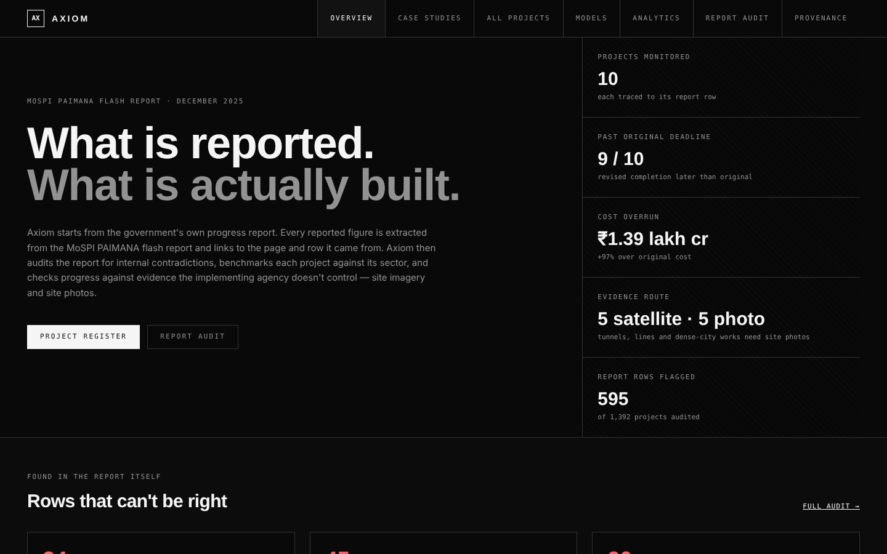
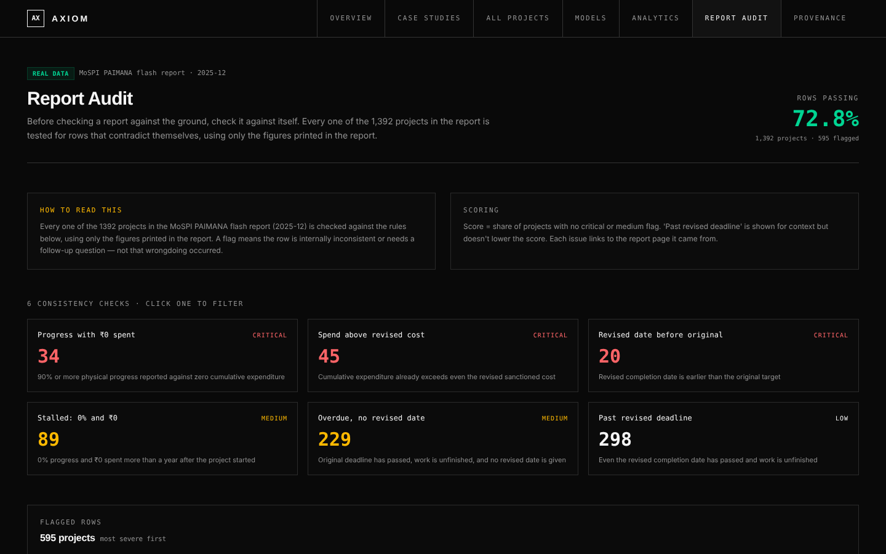
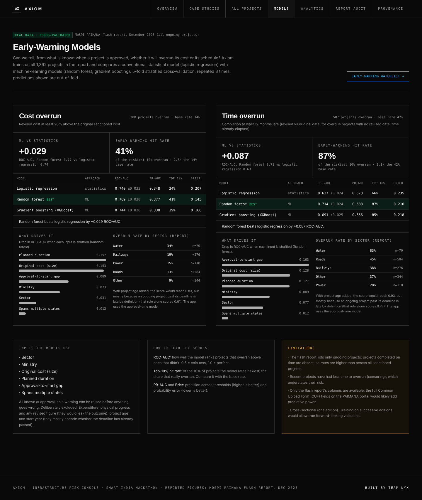
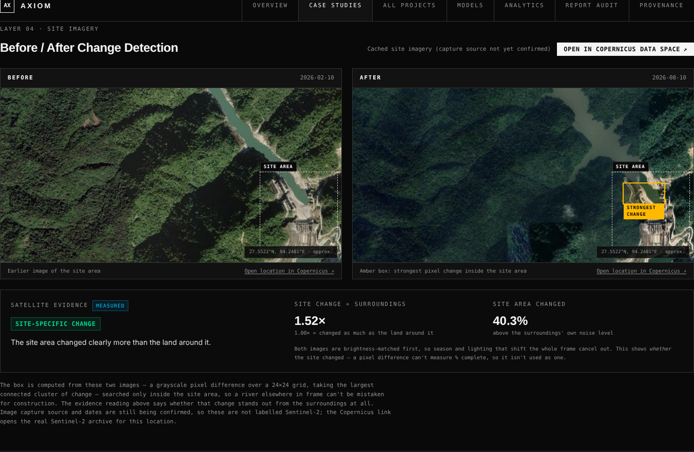
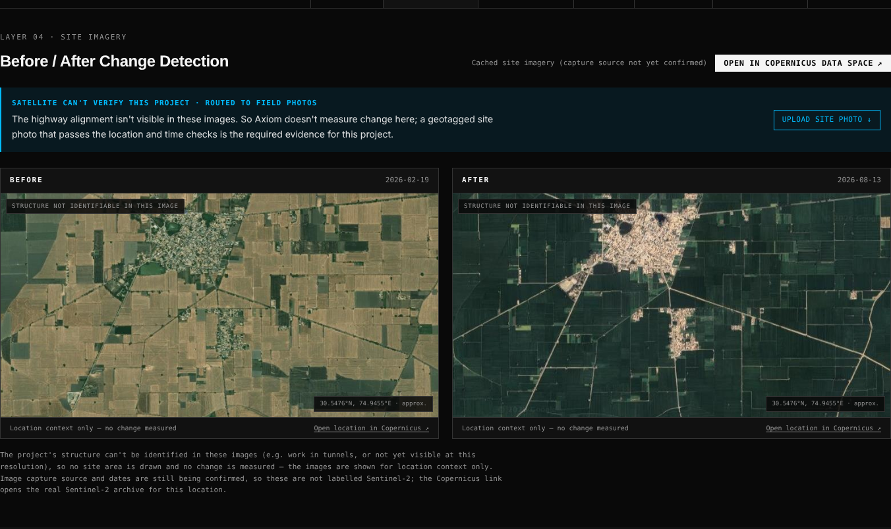

# Project Axiom

**Independent checks on self-reported government infrastructure progress.**
Smart India Hackathon 2026 · Problem statement **SIH26103** (MoSPI) · Built by **Team Nyx**



Every month MoSPI's PAIMANA flash report lists the cost, spending and physical progress of India's large central-sector projects. Every one of those numbers is reported by the agency building the project. Axiom asks three questions about the report:

1. **Does the report agree with itself?** Six consistency checks run over all 1,392 projects in the December 2025 edition. 595 projects have figures that contradict each other, and every flag links to its page in the government PDF.
2. **Which projects will overrun?** Cost- and time-overrun early-warning models are trained on the same 1,392 projects, using only facts known on the day a project is approved, and compared against a conventional statistical baseline.
3. **Does independent evidence agree?** For 10 case studies, satellite imagery or geotagged site photos are checked against what the agency reported. Every photo is checked for location, capture time and duplicates before it can change a score.

Every figure in the console is labelled **real** (printed in the report or fetched from a public source), **derived** (computed from real figures), or **simulated / illustrative**. The *Provenance* page lists each module and its status.

---

## Quick start

**With Docker:**

```bash
git clone https://github.com/SenonaIgnatius/Project-Axiom.git
cd Project-Axiom
docker compose up --build
```

Open **http://localhost:8080**. API docs: http://localhost:8000/docs

**Without Docker** (Python 3.11, Node 20+):

```bash
# terminal 1
cd backend
python -m venv .venv
.venv\Scripts\activate            # macOS/Linux: source .venv/bin/activate
pip install -r requirements.txt
python scripts/download_models.py # trained YOLOv8 weights (optional, see below)
python -m uvicorn app.main:app --reload --port 8000

# terminal 2
cd frontend
npm install
npm run dev -- --port 8080
```

On first start the backend creates `data/axiom.db` and loads the 10 case studies. No API keys are needed.

---

## 1 · Report Audit: does the report agree with itself?



| Check | What it catches |
|---|---|
| Progress with ₹0 spent | ≥ 90% physical progress but zero expenditure |
| Spend above revised cost | cumulative expenditure exceeds the revised sanctioned cost |
| Revised date before original | a "revised" deadline earlier than the original one |
| Zero progress, zero spend | nothing happened more than a year after start |
| Overdue, no revised date | past the original deadline with no new date |
| Past revised deadline | past the revised deadline and still incomplete |

**595 of 1,392 projects** are flagged. A flag means a row is internally inconsistent or needs a follow-up question, not that wrongdoing occurred. Each flag opens the matching page of `flash_report.pdf` with the row highlighted. The **All Projects** page lets you search, filter and sort every project in the report.

*Extraction check:* `python backend/scripts/verify_report_totals.py` compares the extracted rows with the totals printed in the report's Table 1. Project count, original cost (₹29.68 lakh crore) and revised cost (₹35.11 lakh crore) match exactly; expenditure is within 0.32%.

*Manual verification:* `python backend/scripts/make_audit_handcheck_sheet.py` creates a 50-row sample sheet for the team to check by hand against the PDF.

## 2 · Early-warning models: which projects will overrun?



Trained on all 1,392 projects (`backend/scripts/train_overrun_models.py`). The inputs are **only facts known at approval**: sector, ministry, original cost, planned duration, the approval-to-start gap, and whether the project spans several states. Expenditure, progress and revised figures are never used as inputs, since they would give the answer away. Validation is repeated stratified 5-fold cross-validation, and every prediction shown in the app comes from a model that never saw that project.

| Target | Logistic regression (statistics) | Random forest (ML, best) | Riskiest 10% that really overran | Base rate |
|---|---|---|---|---|
| Cost overrun ≥ 20% | ROC-AUC 0.74 | **0.77** | **41%** | 14% |
| Delay ≥ 12 months | ROC-AUC 0.63 | **0.71** | **87%** | 42% |

- **ML vs statistics** (asked for by SIH26103): the random forest beats logistic regression on both targets.
- **Drivers** (permutation importance): the approval-to-start gap, project size and planned duration matter most.
- **Early-warning watchlist:** 92 projects with top-10% predicted risk for an overrun the report doesn't show yet.

## 3 · Independent evidence: 10 case studies

Each case study is a real row from the report. Projects are routed to the evidence that can actually see them.

**Satellite imagery** (5 projects whose structure is visible: dams, rail corridors, roads):



- The search for change runs only inside the located site area, so a river or town elsewhere in the frame can't be mistaken for construction.
- The two images are brightness-matched first, and the site's change is compared with the change in the surrounding land. Subansiri reads **1.52×**, a clear site-specific change.
- This shows *whether* a site changed. A pixel comparison cannot measure percent complete, so it isn't used as one.

**Geotagged site photos** (5 projects satellites can't verify: tunnels, transmission lines, dense-city metro):



Before a photo can change a project's verified progress, `photo_integrity_service.py` checks three things:
- whether its EXIF GPS location is within the sector's radius of the site,
- whether it was taken after the project started and within the last 180 days,
- whether its perceptual hash matches an earlier upload.

A failing photo is still classified and shown, but it cannot move the score. `scripts/make_test_photos.py` makes labelled test copies (on site, 2,000 km away, too old) for demos.

**Transparent risk score:** budget variance 30%, schedule slippage 30%, reported-vs-verified gap 20%, sensors 10%, rainfall 10%. When sensor or rainfall data is unavailable, its weight drops to zero and the rest renormalise. `scripts/weight_sensitivity_check.py` shows the project ranking barely changes under ±20% weight changes (mean Spearman ρ = 0.98).

---

## Honest limitations

- **Satellite images** are a committed cache of before/after pictures. Some carry © Google watermarks, so they're credited to Google and **not** labelled Sentinel-2. `app/services/satellite_imagery_service.py` can fetch real Sentinel-2 L2A scenes from the Copernicus Data Space with free CDSE credentials (`backend/.env`), but the cache hasn't been regenerated that way yet.
- **One report edition.** The models use the December 2025 flash report. The report lists only *ongoing* projects, so projects that finished on time are missing. Later real editions would allow a true forward test, which is the next step.
- **The photo classifier is small:** 30 training and 10 validation images. Its weights come from a GitHub release via `scripts/download_models.py`; without them it falls back to the generic `yolov8n-cls`.
- **Sensors are simulated** (no physical sensors exist), and the escalation notice is a draft that is never sent. Both are labelled as such in the app.
- **The verified-progress figure** for each case study is an illustrative stand-in until a site photo passes the integrity checks.

## Tests

```bash
cd backend && python -m pytest -q tests
```

The tests cover every console endpoint, the Report Audit totals, the models beating their baseline, photo integrity, risk-weight renormalisation, and satellite edge cases. GitHub Actions runs them, plus the frontend type-check and build, on every push.

## Repository layout

| Folder | Contents |
|---|---|
| `backend/` | FastAPI API, risk engine, ML, PAIMANA extraction (`scripts/extract_paimana_dataset.py`) |
| `backend/data/` | extracted report (`paimana/`), model results (`ml/`), cached site images |
| `frontend/` | web console (TanStack Start, React 19, Tailwind v4) |

## Data credits & license

- MoSPI PAIMANA flash report, December 2025 (Government of India)
- Satellite imagery: cached images, partly © Google; Copernicus Sentinel-2 via the Copernicus Data Space Ecosystem where fetched
- Rainfall: Open-Meteo historical archive
- Roboflow Universe construction datasets (CC BY 4.0)

Code under the [MIT License](LICENSE).
